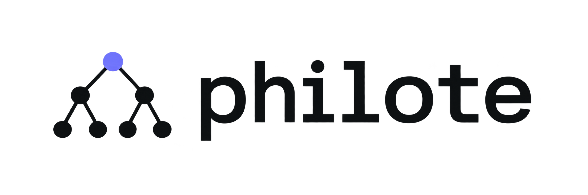

<picture>
  <source media="(prefers-color-scheme: dark)" srcset="docs/assets/logo-dark.png">
  
</picture>

Can we bring Nix-style determinism to AI-driven coding?

Describe your app as an ontology: the things in it, how they relate, and what you can do with them. Philote compiles it to code, from fixed templates wherever it can. Anything AI writes is pinned in a lockfile, so the same ontology always builds the same code.

Status: early. It builds a Hono backend, with AI-written steps pinned in `philote.lock`. A Next.js frontend is next.

## Example

Tinder, for horses. You write what the app is: its data, how the data relates, which parts the API exposes, and what a swipe does.

```
app neighbr {
  backend api: hono {
    resource horses: Horse
    resource swipes: Swipe { only: list, create }
    resource matches: Match { only: list, get }

    endpoint swipe {
      route: POST "/swipe"
      input: { horse: Horse, target: Horse, liked: bool }
      output: Swipe
      errors: same_horse, already_swiped
      steps: record_swipe, match_if_mutual
    }

    step record_swipe(horse: Horse, target: Horse, liked: bool) -> swipe: Swipe {
      fails: same_horse, already_swiped
      intent: "store the swipe; a horse can't swipe itself, or swipe the same horse twice"
    }

    step match_if_mutual(swipe: Swipe) {
      intent: "if this swipe is a like and the target already liked the swiper, create a Match for the two, matched now"
    }
  }
}

enum Breed { arabian, mustang, shetland, clydesdale, other }

entity Horse {
  name: string(max 60)
  handle: slug from name
  breed: Breed
  age: int(min 1, max 40)
  bio: string(max 280)
}

entity Swipe {
  liked: bool
}

entity Match {
  matched_at: datetime
}

Horse has many swipes: Swipe
Swipe belongs to target: Horse (back swiped_by)
Match belongs to first: Horse (back first_matches)
Match belongs to second: Horse (back second_matches)
```

`philote build neighbr.philote` turns that into a runnable Hono server. Every route, rule and error comes from a line above:

```
$ philote tree --depth 3 neighbr.philote
neighbr
  api (backend, hono)
    horses: Horse
      GET /horses
      GET /horses/[id]
      POST /horses
      PATCH /horses/[id]
      DELETE /horses/[id]
    swipes: Swipe
      GET /swipes
      POST /swipes
    matches: Match
      GET /matches
      GET /matches/[id]
    swipe (endpoint)
      POST /swipe
      steps: record_swipe, match_if_mutual
  data (3 entities)
    Horse
    Swipe
    Match
```

`philote expand` shows any part one level down. A new horse needs a name of at most 60 characters, a known breed and an age from 1 to 40. The handle is made from the name:

```
$ philote expand neighbr.philote api/horses
endpoint horses.create {
  route: POST "/horses"
  input: { name: string(max 60), breed: Breed, age: int(min 1, max 40), bio: string(max 280) }
  output: Horse
  errors: invalid_input
}
```

Templates write everything except the inside of each step. Philote writes the step's file, its signature and its errors, then asks a model for the body. The body has to typecheck, or it goes back to the model with the errors. It's pinned in `philote.lock` next to the spec, keyed by a hash of the model and the prompt:

```
step api/record_swipe
key e32c9a061360476a308484b023c98dfdef73922c00fdd3a7b00cc0651d35a54d
model claude-opus-5-5
| if (horse.id === target.id) {
|   fail("same_horse");
| }
| const existing = (all("Swipe") as Swipe[]).find(
|   (s) => s.horse_id === horse.id && s.target_id === target.id
| );
| if (existing) {
|   fail("already_swiped");
| }
| return insert("Swipe", {
|   liked,
|   horse_id: horse.id,
|   target_id: target.id,
| }) as Swipe;
```

Commit the lock. The next build copies the body and doesn't call the model. Change a step's intent and only that step is rewritten, starting from its old body, so the lock diff shows exactly what changed.

Philote doesn't know what a horse is, or what Tinder is. Everything it builds comes from the lines above and the lock, so building again gives the same files byte for byte, and changing one line only changes the code for that line.

## Try it

```sh
go install github.com/3nd3r1/philote/cmd/philote@latest
philote check neighbr.philote  # errors point at the spec line
philote build neighbr.philote  # writes the server to build/api; new steps need the claude CLI
philote build --frozen neighbr.philote  # for CI: never calls a model, fails if a step isn't in the lock
cd build/api && npm install && npm start
```

To work on philote, see [CONTRIBUTING.md](CONTRIBUTING.md).
